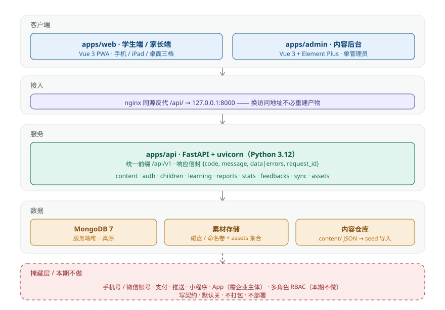

<div align="center">


# Study Club (study-club)

**Learn the characters in your textbook** — a **Chinese literacy + classical poetry** app for primary school grades 1–6

**Free · Open source · Self-hostable**

[](./LICENSE)
[](./THIRD_PARTY_NOTICES.md)
[](./CHANGELOG.md)
[](#tech-stack)
[](#tech-stack)
[](https://study.perryspace.club)

[**Live demo**](https://study.perryspace.club) · [**Repository**](https://gitee.com/perry-space/study-club) · [**Docs**](./docs/README.md) · [**Contributing**](./CONTRIBUTING.md) · [**Changelog**](./CHANGELOG.md) · [**Contact**](#contact)

</div>

---



---

## What is it

A **Chinese literacy + classical poetry starter** app for primary school grades 1–6. Children learn characters from the curriculum word list and self-authored units, read classical poems, and turn "studied" into "remembered" through gamified levels and spaced review; parents can see learning reports. **The data lives on your own server.**

| Item | Content |
| --- | --- |
| One-liner | **Learn the characters in your textbook** — grade-synced literacy + classical poetry |
| Target users | Primary school students (primary), parents (companionship & review), Chinese teachers (optional) |
| Business model | **Free & open**: no paywall, no membership, no ads, no in-app purchase |
| Identity | **Invite code + self-set passcode** — no phone number, no WeChat, **no corporate entity required** |
| Platforms | Phone / iPad / desktop browser (Web + PWA), three responsive breakpoints |
| Data ownership | Learning data on a **self-hosted server**; optional cloud family profile is **off by default and end-to-end encrypted** |
| License | Code **MIT** · Content & docs **CC BY-SA 4.0** |

> The complete "what / positioning / current state" lives in [docs/01-1](./docs/01-产品规划/01-项目概述与定位.md) (Chinese).

---

## Why

I wanted a literacy app for my kid. Every one I tried was disappointing — more ads than content, a paywall two taps in, and no control over the content.

So I wrote one myself.

---

## Core features

- **Server-authoritative** — learning data, child profiles, progress and content all live on the server (MongoDB is the single source of truth); the browser holds no business data, only session credentials and UI preferences.
- **Three responsive breakpoints + PWA** — phone `<768` / iPad `768–1279` / desktop `≥1280`, installable; child-facing minimum tap targets and font sizes.
- **Content-as-repo** — content is `content/**/*.json` (with JSON Schema); changing content needs no release. One `/content/bootstrap` call pulls the full set after sign-in.
- **Invite-code identity** — invite code + self-set passcode (Argon2id / JWT / Ed25519). Open access is a switch: `REQUIRE_INVITE=false`.
- **Free & open** — no paywall. Capabilities that need a corporate entity (phone/WeChat accounts, payments, mini-program, native app) carry contracts but are **disabled by default, not bundled, not deployed**.
- **Self-hostable** — Docker Compose, one service per stack (mongo / api / web / admin); a single machine is enough.
- **Platform-agnostic core** — `packages/core` has zero platform dependencies and is subject-agnostic, leaving room for more subjects later.
- **A complete learning loop** — learning map · flashcards · levels · daily tasks · spaced review · mistake book · poems · stories & rhymes · reports · settings.

---

## Architecture

| Layer | Components | Notes |
| --- | --- | --- |
| Clients | `apps/web` (Vue 3 PWA), `apps/admin` (Vue 3 + Element Plus) | Student/parent app (responsive); admin console is a single-admin internal tool |
| Ingress | nginx same-origin `/api/` proxy | Frontend and API share an origin — avoids mixed-content and CORS issues; changing the public address needs no rebuild |
| Service | `apps/api` (Python 3.12 + FastAPI + uvicorn) | Prefix `/api/v1`, envelope `{code, message, data\|errors, request_id}` |
| Data | MongoDB 7 · asset disk/named volume + `assets` · `content/` repo | Business data: MongoDB is the single source of truth; content JSON is imported via `scripts/seed` |
| Hidden layer | phone/WeChat accounts · payments · push · mini-program · native app | Require a corporate entity: contracts only, off by default, not bundled |
| Not in this release | multi-role RBAC admin | A single admin is enough; multi-role is over-engineering (no corporate entity involved): contracts only |

**Two rules that matter most**

1. If `window` / `document` / `uni.*` appears in `packages/core`, cross-platform reuse drops from 95% to 0 — and the core must stay **subject-agnostic**.
2. **All data access goes through the repository layer and API client** — components never read/write storage directly.

---

## Tech stack

| Layer | Choice |
| --- | --- |
| Frontend (Web) | Vue 3 + TypeScript + Vite + Pinia + vue-router (PWA) |
| Cross-platform core | **`packages/core`** — algorithms / stores / types / contracts / flags / repository interfaces, **zero platform deps + subject-agnostic** |
| Subject package | `packages/subject-hanzi` (literacy-specific logic; never in `core`) |
| Design tokens | `packages/tokens` (breakpoints / tap targets / colors) |
| Data store | **MongoDB 7 (server-side source of truth)**; browser keeps only credentials and UI preferences |
| Identity | **Invite code + self-set passcode** (Argon2id / JWT / Ed25519) |
| Content delivery | **In-repo JSON → MongoDB → `/content/*` API** |
| Backend | Python 3.12 + **FastAPI** + MongoDB 7 (async motor) |
| Admin console | Vue 3 + Element Plus (single admin) |
| Deploy | **Docker Compose, one service per stack** (mongo / api / web / admin) + `network_mode: host` + nginx |
| Toolchain | Node ≥20 · `pnpm@9.12.0` · Python 3.12 · Docker Compose |

---

## Quick start

> Prerequisites: Node ≥ 20, `pnpm@9.12.0`, Python 3.12, Docker + Docker Compose.

**Bring up the whole stack** (database → backend → frontend):

```bash
cp .env.example .env          # generate env vars (ports & feature flags)
scripts/dev/bootstrap.sh      # optional one-step setup (dirs, keys, icons)
scripts/dev/up-all.sh         # start db → api → web (each orchestrated independently)
scripts/seed/seed.sh          # first run: import content & seed data
```

Then:

| Purpose | URL |
| --- | --- |
| **Student / parent app (main entry)** | `http://localhost:8080/` |
| LAN devices (phone / iPad on same Wi‑Fi) | `http://<host-LAN-IP>:8080/` |
| Backend API | `http://localhost:8000/api/v1` |
| Swagger docs | `http://localhost:8000/docs` |
| Health check | `http://localhost:8000/api/v1/health` |

**Frontend only (dev server, hot reload):** `pnpm install && pnpm dev` → `http://localhost:5173/`.

> Content contributors don't need the full stack — just edit `content/**/*.json` and run `pnpm content:validate`. See [CONTRIBUTING.md](./CONTRIBUTING.md).

---

## Documentation

- **User docs site** (VitePress, English + Chinese): [`website/`](./website).
- **Design docs** (for developers): [`docs/`](./docs/README.md) — Chinese, entry point is the documentation map.

Key design docs: [01-1 Overview](./docs/01-产品规划/01-项目概述与定位.md) · [02-1 Architecture](./docs/02-系统架构/01-系统总体架构与技术选型.md) · [02-3 Storage & backend](./docs/02-系统架构/03-存储与后端策略.md) · [02-5 Identity & access](./docs/02-系统架构/05-邀请码身份与准入体系.md) · [04-1 API](./docs/04-接口设计/01-API接口定义.md).

---

## Roadmap

**Done (v0.1, first working version)**

- [x] Monorepo (`packages/core` + `packages/tokens` + `packages/subject-hanzi` + `apps/web` + `apps/api` + `apps/admin`)
- [x] `content/` repo with JSON Schema + validation script (`pnpm content:validate`)
- [x] Responsive Web PWA with a server-side data repository and feature flags
- [x] Cloud backend (invite identity / content / child profiles / learning & review / reports / anonymous stats / optional encrypted sync / single admin)
- [x] Docker Compose per-service orchestration + ops scripts + per-table seed data

**In progress**

- [ ] **Content volume**: characters, poems, stories & rhymes (the biggest gap today)
- [ ] Remaining P0 admin pages: poem management, unit & level authoring, bulk import/export

**Planned**

- [ ] CI: content schema validation + `vue-tsc` type check + "hidden features never bundled" assertion
- [ ] Cloud speech assessment (optional paid; hidden entirely without a key)
- [ ] More subjects (the subject-package split leaves room)

---

## Design principles

- **Server-authoritative** — data on the server; the browser keeps only credentials and UI preferences.
- **Content and code separated** — content as in-repo JSON; no code change to edit content.
- **Platform-agnostic core** — zero platform deps, subject-agnostic; subject logic lives in subject packages.
- **Repo as source of truth** — content, API contracts and feature flags all live in the repo.
- **Free-first** — paid capabilities are optional, degradable and off by default.
- **Self-hostable & portable** — light backend, exportable data, no cloud lock-in.
- **No corporate entity required** — but a server is fine: invite identity, content console, anonymous stats and optional sync are all live.

---

## Content copyright red lines

Because the project is **open source**:

- ⛔ **No textbook mapping data** (unit order and lesson titles belong to publishers' compilation rights)
- ⛔ **No assets without traceable licensing**
- ✅ Every content source must be registered in `content/sources.json` and [`THIRD_PARTY_NOTICES.md`](./THIRD_PARTY_NOTICES.md) before it can be included

---

## Contributing

All contributions are welcome — code, content (JSON only), docs, tests, translations, issues and reviews.

- Start with [**CONTRIBUTING.md**](./CONTRIBUTING.md).
- The project follows the [Contributor Covenant Code of Conduct](./CODE_OF_CONDUCT.md); report security issues per [SECURITY.md](./SECURITY.md).
- Look for issues labeled `good first issue`.

> AI tools are welcome — but **every PR you submit must be one you understand, verified, and own**.

---

## License

| Item | License |
| --- | --- |
| Code | [MIT](./LICENSE) |
| Content & docs | CC BY-SA 4.0 |
| Third-party assets | distributed with their own licenses, listed in [THIRD_PARTY_NOTICES.md](./THIRD_PARTY_NOTICES.md) |

---

## Contact

Questions, ideas or want to help? Email **perry@perryspace.club**.
